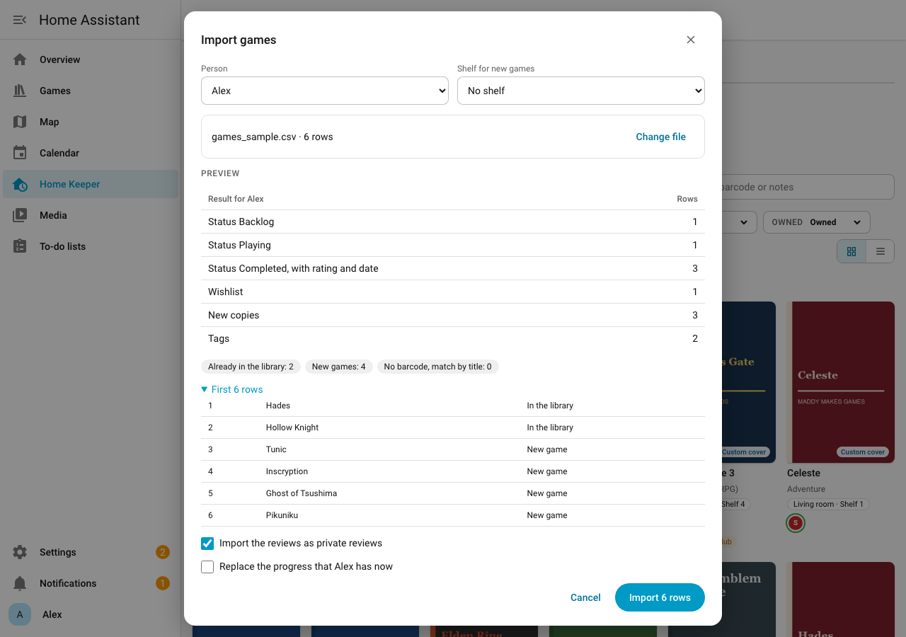

# Import and export

The library supports an import and an export of a CSV file in its own format. Use it to
edit many books in a spreadsheet, or to move the books from 1 Home Assistant to another.
To move the whole library with Home Keeper, use the
[Home Keeper export](#home-keeper-export-includes-your-library).

## Import a file

1. Open the **Books** page of the Library tab, and select **Import**.
2. Select the **Person** whose reading status the file holds.
3. Select a **Shelf for new books**, or no shelf.
4. Select **Choose file** and select the CSV file. The file must be 5 MB or smaller.
5. Read the **Preview**. It shows the counts and the result for the first 200 rows. The
   preview changes nothing.
6. Select **Import** to write the rows.

Options:

- **Import reviews and private notes as private notes**: on by default.
- **Replace the reading status that** *person* **has now**: off by default. With it off,
  a book that already has a reading status for the person keeps it.

The file needs a `title` column. The easiest way to start is an export: it has every
column.

## How rows match books

The library looks for each row in this order:

1. The book ID.
2. The barcode.
3. The title and the first author.

A row that matches no book adds a new book.

## What a row gives

| Columns | Library |
|---|---|
| Book columns, such as `title`, `authors` and `barcode` | The details of the book |
| `copy_id`, `format`, `condition` and the other copy columns | 1 copy. A row with no `copy_id` adds a copy only to a book with no copy. |
| `location` | The shelf of the copy, as *room* / *bookcase* / *shelf*. Else the shelf for new books. |
| `status`, `rating`, `started`, `finished`, `read_count` | The reading status of the person |
| `private_notes` | The private notes of the person |
| `wishlist`, `wishlist_buy` | The wishlist of the person, if the book has no copy |

A list cell, such as `authors` or `tags`, separates its items with `; `.

## Export

Open the **Settings** page of the Library tab. In **Export**, select a person or **All
books, no reading status**, and select **Export CSV**. The file has 1 row for each copy,
and 1 row for each book with no copy. The file name has the date, such as
`games-2026-10-05.csv`.

## Home Keeper export includes your library

The [Home Keeper export](https://prestomation.github.io/ha-home-keeper/docs/guide/import-export)
holds the library. 1 export and 1 import move Home Keeper and the library together. The
library section has these records:

- The rooms, bookcases and shelves.
- The books, the copies and the wishlist.
- The loans.
- The reading status and the settings of each person.

A **.zip** export also holds the cover files. A **YAML** export has no covers. The
export result counts each cover that it skips.

### How the import matches records

The import adds a record or updates the record that matches. It never deletes a record
that is not in the file.

- A book matches by its ID, then the barcode, and the title and first author.
- A room matches by its ID, then its name. A bookcase or a shelf matches by its ID, then
  its name in the same room or bookcase.
- A copy or a loan matches by its ID.
- A person matches by the ID on this Home Assistant, then by the name. An area and the
  to-do list of a wishlist match the same way.

If no person matches, the preview shows a warning. The import then skips these records
of that person:

- The reading status and the settings.
- The wishlist entries and the borrowed books.

To keep these records, give the person the same name on the new Home Assistant.

After the import, the library makes the Home Keeper task of each open loan and the to-do
item of each wishlist book again.

### Services

Home Keeper calls 2 admin-only services. A script can call them too:

- `home_keeper_games.export_data` returns the library section.
- `home_keeper_games.import_data` reads a library section. With `dry_run: true` it only
  reports the changes.
