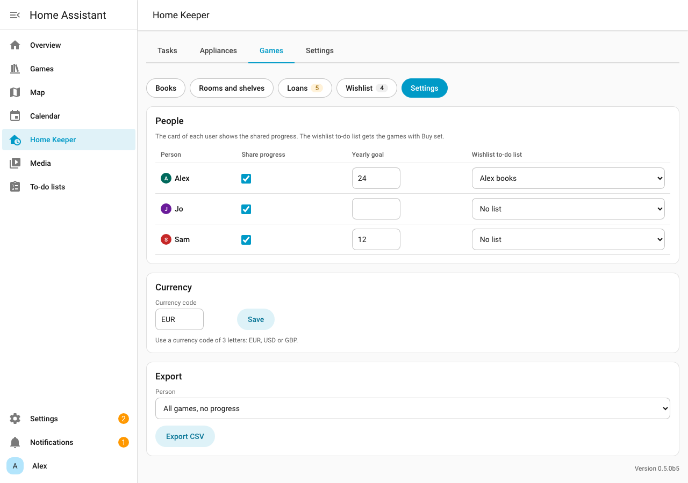

# People and privacy

The library uses the people of Home Assistant. Each progress row, rating and review
belongs to 1 Home Assistant `person`. A user of Home Assistant is linked to a person
in **Settings → People**. The library acts for the person of the user who signs in.

## What each user can do

| Operation | Admin | Other user |
|---|---|---|
| Manage rooms, shelves, books, copies, covers, loans and the wishlist | Yes | No |
| Scan, import and export | Yes | No |
| Set the play progress, rating, play time and review of their own person | Yes | Yes |
| Set the play progress of another person | Yes | No |
| Turn **Share progress** on or off, and set the yearly goal, for their own person | Yes | Yes |
| Select the wishlist to-do list of a person | Yes | No |
| Read the books, the shelves and the covers | Yes | Yes |

The Library tab is in the Home Keeper panel, which only admins can open. Other users use
the [dashboard card](../views/dashboard-card.md), the entities and the services. A user
with no linked person can read the library, and cannot set a play progress.

## What other users read

Admins read the whole library. Other users do not read:

- the price, the value and the source of a copy;
- the name of the person who borrowed or lent a book;
- the review of another person;
- the play progress of a person who turned **Share progress** off.

Shared notes are for the whole household. A review is for 1 person and the admins.

## People settings

An admin sets these in the **Settings** page of the Library tab, for each person:

- **Share progress**: other users see the play progress of the person, with no review. It
  is on by default.
- **Yearly goal**: the number of games to complete this year. The card and a sensor show it.
- **Wishlist to-do list**: the to-do list that gets the wishlist books with **Buy** set
  ([Work in progress](work-in-progress.md)).

The **Settings** page also shows the currency, and has the
CSV export of the library.

## Entities

Each person gets a **Backlog** to-do list and 2 sensors: **games completed this year** and
**playing now**. Home Assistant shows each entity to every user, so the library applies
its privacy rules to these entities:

- Only the user of the person and an admin can change the **Backlog** list of that
  person. An automation can change it too.
- If **Share progress** is off, the 3 entities of the person are unavailable. They come
  back when **Share progress** is on again.
