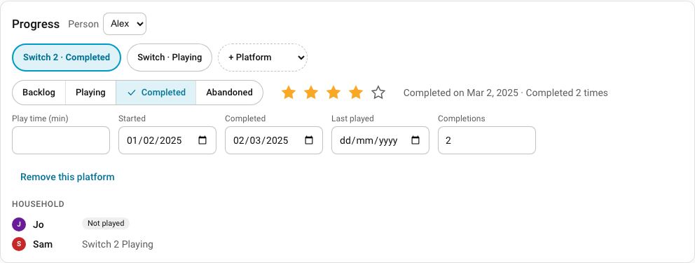

# Work in progress

Home Keeper Games is a change of Home Keeper Library from books to video games. The change
is in progress, and there is no release yet. The integration still keeps books in this
version, so this guide does not describe each page of the tab.

The guide for games comes with the games model: each game with its copies for each
console, and the play status of each person.

## What works now

- The **Games** tab of the Home Keeper panel, with the rooms, shelves and items.
- A barcode scan into a shelf. A new barcode asks for the title.
- Copies with a platform, a physical or digital format, and the barcode of the case.
- [Play progress](#play-progress) for each person on each platform.
- Loans with a Home Keeper task, and a wishlist for each person.
- A CSV import and export in the format of Home Keeper Games.
- The [dashboard card](../views/dashboard-card.md), the sensors and the
  [services](../automation/services.md).

## Play progress

Each person has 1 progress row for each platform of a game. A row has the play status
(**Backlog**, **Playing**, **Completed** or **Abandoned**), a rating, the play time in
minutes, the start, completion and last-played dates, the number of completions and a
private review.

Open a game in the **Games** tab. The **Progress** part has 1 chip for each platform that
has a copy or a row. Select a chip to edit the row of that platform. Select
**+ Platform** to add a row for another platform. **Remove this platform** removes the
row. The household lines show the shared rows of the other people, such as "Switch 2
Completed".

When the status changes to **Completed**, the date of completion is today and the number
of completions goes up by 1.

## Home Keeper export

The Home Keeper export holds the section of Home Keeper Games. 1 export and 1 import move
Home Keeper and Home Keeper Games together. The import adds a record or updates the record
that matches, and never deletes a record that is not in the file.
