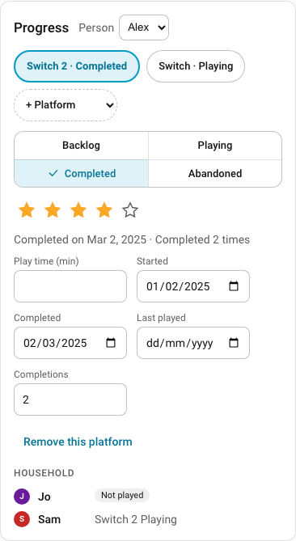
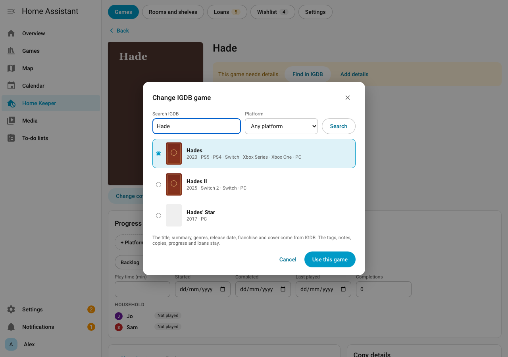
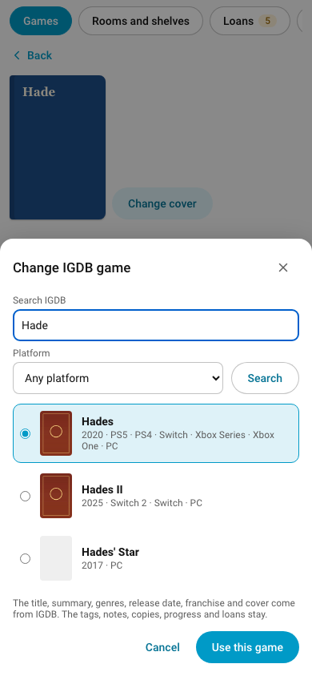

# Work in progress

Home Keeper Games is a change of Home Keeper Library from books to video games. The change
is in progress, and there is no release yet, so this guide does not describe each page of
the tab. Some action names and descriptions in Home Assistant still say "book".

## What works now

- The **Games** tab of the Home Keeper panel, with the rooms, shelves and items.
- A barcode scan into a shelf. A new barcode asks for the title.
- Copies with a platform, a physical or digital format, and the barcode of the case.
- [Play progress](#play-progress) for each person on each platform.
- [IGDB game](#igdb-game): correct the IGDB details of a game.
- A [Telegram blueprint](../automation/telegram.md) that adds a game from a chat.
- Loans with a Home Keeper task, and a wishlist for each person.
- A CSV import and export in the format of Home Keeper Games.
- The [dashboard card](../views/dashboard-card.md), the sensors and the
  [services](../automation/services.md).

## Play progress

Each person has 1 progress row for each platform of a game. A row has the play status
(**Backlog**, **Playing**, **Completed** or **Abandoned**), a rating, the play time in
minutes, the start, completion and last-played dates, the number of completions and a
private review.

Open a game in the **Games** tab. The **Progress** part has 1 chip for each platform that
has a copy or a row. Select a chip to edit the row of that platform. Select
**+ Platform** to add a row for another platform. **Remove this platform** removes the
row. The household lines show the shared rows of the other people, such as "Switch 2
Completed".

When the status changes to **Completed**, the date of completion is today and the number
of completions goes up by 1.

## Home Keeper export

The Home Keeper export holds the section of Home Keeper Games. 1 export and 1 import move
Home Keeper and Home Keeper Games together. The import adds a record or updates the record
that matches, and never deletes a record that is not in the file.

## IGDB game

With the [IGDB keys](installation.md#igdb-keys), a game gets its details and its cover
from IGDB. If an automation added the wrong game, or IGDB did not find the title, correct
the game in the tab:

1. Open the game in the **Games** tab.
2. Select **Change IGDB game**. For a game that needs details, you can also select
   **Find in IGDB** in the banner.
3. The dialog searches the title of the game, on the platform of its copies. To search
   again, change the text or the platform and select **Search**.
4. Select the correct game, then select **Use this game**.

The title, summary, genres, release date, franchise and cover come from IGDB. The tags,
notes, copies, progress and loans do not change. A cover that you uploaded stays. A game
that is already in the library shows **In library**, and you cannot select it.

