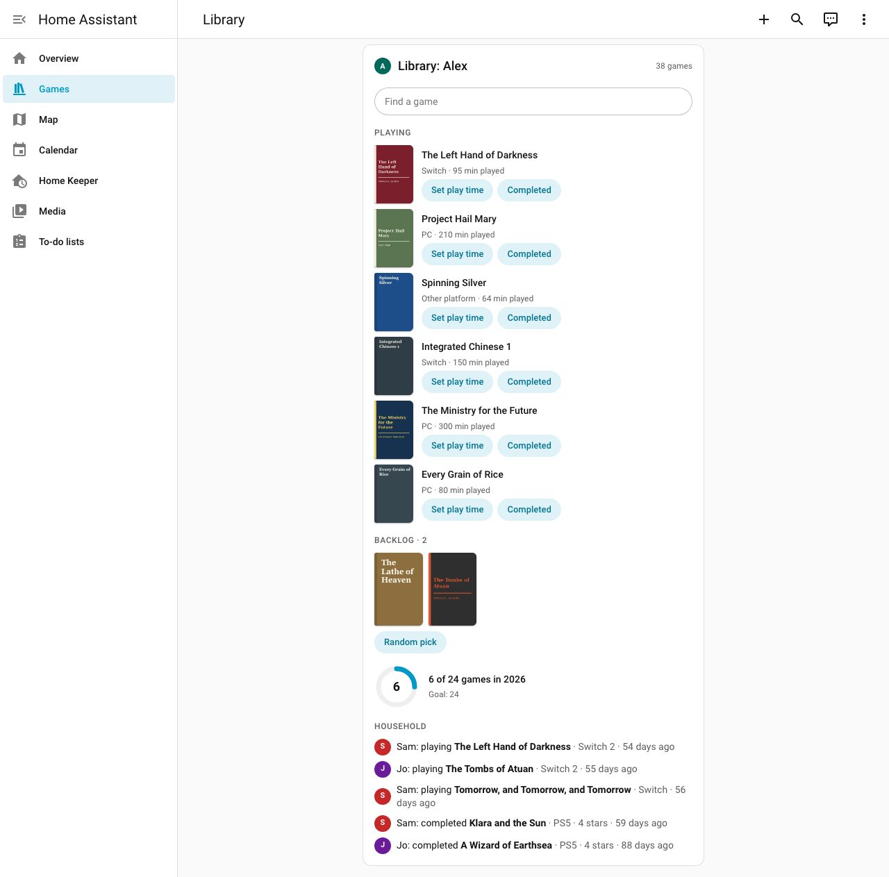
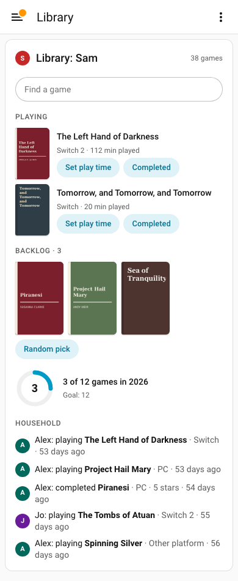

# Dashboard card

Home Keeper Games supports a dashboard card, **Home Keeper Games**
(`custom:home-keeper-games-card`), that shows the play progress of 1 person. Every user can
add it to a dashboard, such as the dashboard of a phone or a wall tablet. The card
resource is registered automatically.



## Add the card

1. Open a dashboard and select **Edit dashboard**.
2. Select **Add card**, and select **Home Keeper Games**.
3. Select the sections, and select **Save**.

## Sections

| Section | What it shows |
|---|---|
| **Search** | A search of the library. Each result shows its shelf. |
| **Playing** | The games that the person plays now, with the platform and the play time. Select **Set play time** to change the time, or **Completed** when the game is done. |
| **Backlog** | The covers of the games to play next. Select **Random pick** to get 1 at random. |
| **Yearly goal** | The games completed this year, against the goal of the person. |
| **Household activity** | The progress of the other people who share their progress, with the platform. |

Turn each section on or off in the card editor.

## Person

The card shows the person of the user who looks at it. In the card editor, an admin can
select another person. A user with no linked person sees **No person is linked to this
user.**

The card shows only what the user can read
([People and privacy](../start/people-and-privacy.md)). The card has no management
controls: use the Library tab for those.

## YAML

```yaml
type: custom:home-keeper-games-card
person: alice   # optional, the id of a Home Assistant person
title: Our games  # optional
search: true
playing: true
backlog: true
goal: true
household: true
```

## Phone



The card works at phone width.
